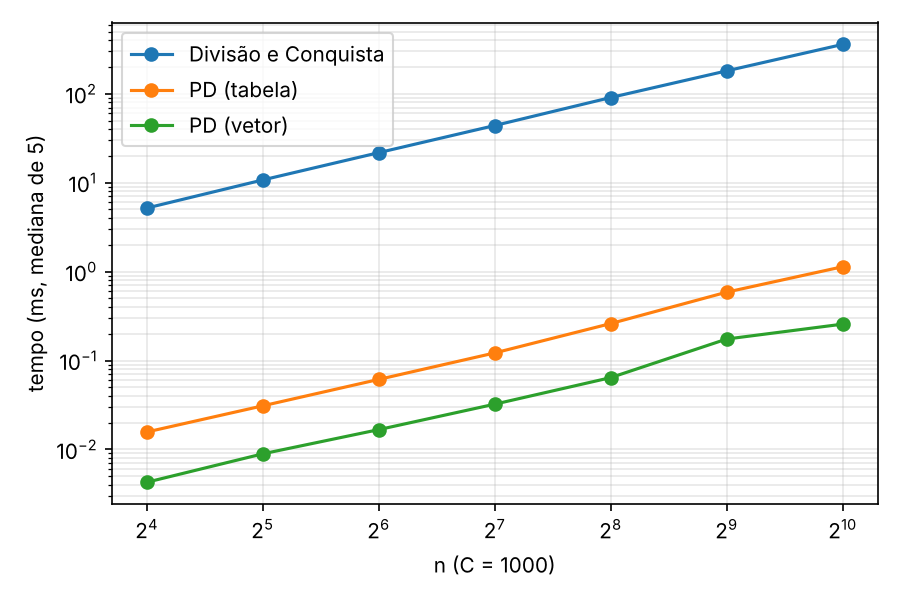
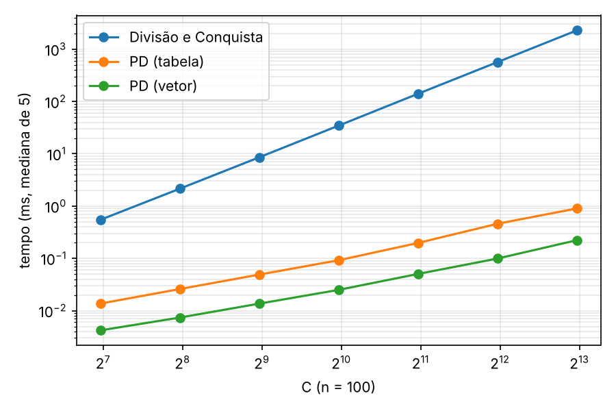

# Trabalho Final de APA: Implementação e Análise de Estratégias de Algoritmos para Solução de Problema NP

## Mochila Binária (0-1 Knapsack)

> **Documento parcial.** Ele segue a estrutura do PDF final (seções 1 a 8), mas as seções 4, 5 e 6 cobrem apenas **Divisão e Conquista (D&C)** e **Programação Dinâmica (PD)**. As demais estratégias entram na integração. Trechos entre `< >` devem ser preenchidos.

---

## 1. Autores

*(Ordenar alfabeticamente na versão final.)*

| Nome completo | Matrícula | Estratégias |
|---|---|---|
| `BRUNO FERREIRA SILVA` | `202503283` | Força Bruta e Backtracking |
| `TIAGO SALES RIBEIRO` | `202503313` | Algoritmo Guloso e Algoritmo Aproximado/Heurística |
| `VICTOR RANGEL TASSE MAGALHÃES` | `202503314` | Divisão e Conquista e Programação Dinâmica |

---

## 2. Introdução

### 2.1 Descrição do problema

Uma mochila suporta peso total de no máximo $C$. Há $n$ itens disponíveis: o item $i$ tem peso $p_i$ e valor $v_i$, e cada um pode ser levado inteiro ou deixado de fora. Não é possível fracionar um item nem levar duas cópias dele, daí o nome "0-1". A pergunta é se existe uma escolha de itens que caiba na mochila e cujo valor total atinja pelo menos uma meta $V$.

**Versão de decisão (o problema sorteado).** Dada uma instância $I = (\{(p_i, v_i)\}_{i=1}^{n},\ C,\ V)$, com $p_i, v_i, C, V \in \mathbb{Z}_{\geq 0}$, existe $S \subseteq \{1,\dots,n\}$ tal que

$$\sum_{i \in S} p_i \leq C \quad\text{e}\quad \sum_{i \in S} v_i \geq V\,?$$

De forma equivalente, existe $x \in \{0,1\}^n$ com $\sum_i p_i x_i \le C$ e $\sum_i v_i x_i \ge V$.

**Versão de otimização.** Calcular

$$\mathrm{OPT}(I) = \max\Big\{\sum_{i\in S} v_i \;:\; S \subseteq \{1,\dots,n\},\ \sum_{i\in S} p_i \leq C\Big\}.$$

Resolver a otimização resolve a decisão: a resposta é **SIM** se, e somente se, $\mathrm{OPT}(I) \geq V$. As estratégias deste trabalho seguem esse caminho.

**Tamanho da entrada.** Com os inteiros codificados em binário, a instância ocupa

$$|I| = \Theta\big(n \cdot \log_2(\max_i\{p_i, v_i\}) + \log_2 C + \log_2 V\big) \text{ bits}.$$

Essa medida é a referência para dizer se um algoritmo é polinomial (Seções 3 e 5.5).

### 2.2 Aplicações práticas

O modelo aparece sempre que é preciso escolher um subconjunto de itens indivisíveis sob um único orçamento [6]:

- **Seleção de projetos e orçamento de capital.** Cada projeto tem um custo (peso) e um retorno esperado (valor), e o orçamento é $C$.
- **Carregamento de carga.** Cada volume, contêiner ou pacote tem um peso e um valor de frete, e o veículo tem capacidade $C$.
- **Alocação de recursos computacionais.** Cada tarefa ou serviço consome memória ou CPU e traz um benefício, e o servidor tem limite $C$.
- **Montagem de contexto em sistemas com LLM (RAG).** Cada trecho recuperado custa um número de tokens e tem uma pontuação de relevância, e a janela de contexto tem $C$ tokens.
- **Criptografia.** O criptossistema de Merkle–Hellman se baseou na dificuldade de uma variante da mochila (soma de subconjuntos) [7]. Ele foi quebrado depois, e o caso ilustra por que "NP-difícil no pior caso" não garante instâncias difíceis na prática.

Por ser NP-completo (Seção 3.6), o problema não tem algoritmo polinomial conhecido. Por isso faz sentido comparar estratégias de projeto de algoritmos diferentes: exatas exponenciais, exatas pseudo-polinomiais e aproximadas.

### 2.3 Organização

A Seção 3 prova que o problema pertence a NP. As Seções 4 a 6 descrevem as implementações, a complexidade de cada uma e os resultados experimentais. A Seção 7 conclui o trabalho.

---

## 3. Prova de que o problema pertence à classe NP

### 3.1 Definição utilizada

Segundo [1, seç. 34.2], uma linguagem $L$ pertence a **NP** se, e somente se, existem um algoritmo verificador $A$ de tempo polinomial e uma constante $k$ tais que

$$L = \{\, x \in \{0,1\}^* : \exists\, y,\ |y| = O(|x|^k),\ A(x, y) = 1 \,\}.$$

A cadeia $y$ é o **certificado**. O verificador não precisa encontrar a solução, apenas conferir em tempo polinomial uma solução proposta.

Seja $\text{MOCHILA-01} = \{\langle I \rangle : I \text{ é instância com resposta SIM}\}$.

### 3.2 Certificado

O certificado é o conjunto $S$ dos itens escolhidos, codificado como o vetor característico $y \in \{0,1\}^n$ (ou como a lista dos índices escolhidos). Logo $|y| \le n \le |I|$, e o tamanho do certificado é polinomial (linear) no tamanho da entrada.

### 3.3 Verificador

```
VERIFICA-MOCHILA(I, y):
1  se |y| ≠ n: rejeita
2  P ← 0;  W ← 0
3  para i ← 1 até n:
4      se y_i = 1:
5          P ← P + p_i
6          W ← W + v_i
7  se P ≤ C e W ≥ V: aceita
8  senão: rejeita
```

A implementação usada no trabalho recebe a lista de índices. Ela também rejeita índices repetidos, o que garante a restrição "0-1":

```cpp
bool verificarCertificado(const Instancia& instancia, const std::vector<int>& selecionados) {
    const std::size_t n = instancia.itens.size();
    std::vector<bool> usado(n, false);
    long long pesoTotal = 0;
    Valor valorTotal = 0;
    for (int indice : selecionados) {
        if (indice < 0 || paraIndice(indice) >= n || usado[paraIndice(indice)]) {
            return false;  // índice inválido ou item repetido (viola o "0-1")
        }
        const std::size_t i = paraIndice(indice);
        usado[i] = true;
        pesoTotal += instancia.itens[i].peso;
        valorTotal += instancia.itens[i].valor;
    }
    return pesoTotal <= instancia.capacidade && valorTotal >= instancia.alvo;
}
```

### 3.4 O verificador executa em tempo polinomial

- O laço das linhas 3–6 executa $n$ iterações, cada uma com um número constante de comparações e somas.
- As somas $P$ e $W$ não passam de $n \cdot \max_i\{p_i, v_i\}$, então têm $O(\log n + \log \max_i\{p_i, v_i\})$ bits. Cada soma ou comparação custa tempo linear nesse número de bits, o que é $O(|I|)$.
- As comparações da linha 7 custam $O(\log C + \log V + \log n + \log\max_i\{p_i,v_i\}) = O(|I|)$.

Portanto, o tempo total é $O(n \cdot |I|) = O(|I|^2)$, que é polinomial no tamanho da entrada. Contando as operações aritméticas como $O(1)$, como no restante do trabalho, o custo é $\Theta(n)$.

### 3.5 Corretude do verificador

- **Completude.** Se $\langle I \rangle \in \text{MOCHILA-01}$, existe $S$ com $\sum_{S} p_i \le C$ e $\sum_{S} v_i \ge V$. O vetor característico $y$ de $S$ faz o verificador calcular $P = \sum_{S} p_i \le C$ e $W = \sum_{S} v_i \ge V$, e ele aceita.
- **Consistência.** Se o verificador aceita $(I, y)$, o conjunto $S = \{i : y_i = 1\}$ satisfaz as duas restrições, porque são exatamente as condições testadas na linha 7. Então $\langle I \rangle \in \text{MOCHILA-01}$. Se a instância é NÃO, nenhum $y$ é aceito.

Pelas Seções 3.2 a 3.5 e pela definição da Seção 3.1, **MOCHILA-01 ∈ NP**. $\blacksquare$

### 3.6 Complemento: MOCHILA-01 é NP-completo

O enunciado pede apenas a pertinência a NP, mas a NP-dificuldade justifica a comparação entre estratégias. O problema está entre os 21 problemas NP-completos de Karp [5]. Uma redução direta parte da **Soma de Subconjuntos**, que é NP-completa [1, seç. 34.5.5]:

- Dada uma instância $(\{s_1,\dots,s_n\}, t)$ de Soma de Subconjuntos, construa a instância de mochila com $p_i = v_i = s_i$ e $C = V = t$. A construção leva tempo $O(n)$.
- Para qualquer $S$, vale $\sum_S s_i \le t$ e $\sum_S s_i \ge t$ se, e somente se, $\sum_S s_i = t$. As duas instâncias têm, portanto, a mesma resposta.

Assim, $\text{SOMA-SUBCONJ} \le_p \text{MOCHILA-01}$, e o problema é NP-difícil. Somado à Seção 3.5, ele é **NP-completo**.

---

## 4. Implementação

### 4.1 Organização do código

| Arquivo | Responsabilidade |
|---|---|
| `include/mochila.hpp` | Tipos (`Item`, `Instancia`, `Resultado`) e contratos de todas as estratégias |
| `src/mochila.cpp` | Leitura de instância, gerador aleatório reprodutível, verificador de certificado |
| `src/divisao_conquista.cpp` | Estratégia D&C |
| `src/programacao_dinamica.cpp` | Estratégia PD (tabela completa e vetor único) |
| `src/main.cpp` | Execução de uma instância e benchmark (tempo + contagem de operações) |
| `tests/testes.cpp` | Casos de borda e comparação com oráculo de força bruta em 300 instâncias aleatórias |
| `scripts/graficos.py` | Geração dos gráficos a partir do CSV do benchmark |

Linguagem: C++17, compilado com `g++ -O2`. Formato de entrada:

```
n C V
p_1 v_1
...
p_n v_n
```

Cada estratégia devolve um `Resultado` com o melhor valor, a resposta da decisão, o certificado (quando reconstruído) e o número de execuções da **operação barômetro**, usada na análise por contagem de instruções [2].

### 4.2 Divisão e Conquista

A divisão é feita sobre o **conjunto de itens**. Para um subconjunto de itens $X$, define-se o perfil

$$f_X(c) = \max\Big\{\sum_{i\in S} v_i : S \subseteq X,\ \sum_{i\in S} p_i \leq c\Big\}, \qquad c = 0,\dots,C.$$

- **Dividir:** o intervalo de itens $[\text{ini}, \text{fim})$ é partido ao meio em $X_E$ e $X_D$.
- **Conquistar:** calcula-se recursivamente $f_{X_E}$ e $f_{X_D}$. O caso base é um único item: $f_{\{i\}}(c) = v_i$ se $p_i \leq c$, e $0$ caso contrário.
- **Combinar:** como $X_E \cap X_D = \emptyset$, toda solução de $X_E \cup X_D$ é a união de uma solução de cada metade, que dividem a capacidade entre si:

$$f_{X_E \cup X_D}(c) = \max_{0 \leq a \leq c}\ \big(f_{X_E}(a) + f_{X_D}(c-a)\big).$$

Essa operação é uma convolução $(\max, +)$. A resposta final é $f_{\{1..n\}}(C)$.

Os subproblemas $X_E$ e $X_D$ são **disjuntos e independentes**: nenhum perfil é calculado duas vezes. Essa é a característica de D&C que o separa da PD, cujos subproblemas se sobrepõem [1, cap. 4 e 15].

```cpp
/** @brief Caso base: um único item cabe (valor) ou não cabe (0) em cada capacidade. */
Perfil resolverItemUnico(const Item& item, std::size_t capacidade, Contador& operacoes) {
    const std::size_t peso = paraIndice(item.peso);
    Perfil perfil(capacidade + 1, 0);
    for (std::size_t c = 0; c <= capacidade; ++c) {
        ++operacoes;
        perfil[c] = (peso <= c) ? item.valor : 0;
    }
    return perfil;
}

/** @brief Combina dois perfis disjuntos por convolução (max, +). Custo (C+1)(C+2)/2. */
Perfil combinar(const Perfil& esquerda, const Perfil& direita, std::size_t capacidade, Contador& operacoes) {
    Perfil combinado(capacidade + 1, 0);
    for (std::size_t c = 0; c <= capacidade; ++c) {
        Valor melhor = 0;
        for (std::size_t a = 0; a <= c; ++a) {
            ++operacoes;
            melhor = std::max(melhor, esquerda[a] + direita[c - a]);
        }
        combinado[c] = melhor;
    }
    return combinado;
}

/** @brief Resolve o subconjunto de itens [inicio, fim), com fim - inicio ≥ 1. */
Perfil resolverIntervalo(const std::vector<Item>& itens, std::size_t inicio, std::size_t fim,
                         std::size_t capacidade, Contador& operacoes) {
    if (fim - inicio == 1) {
        return resolverItemUnico(itens[inicio], capacidade, operacoes);
    }
    const std::size_t meio = inicio + (fim - inicio) / 2;
    const Perfil esquerda = resolverIntervalo(itens, inicio, meio, capacidade, operacoes);
    const Perfil direita = resolverIntervalo(itens, meio, fim, capacidade, operacoes);
    return combinar(esquerda, direita, capacidade, operacoes);
}

Resultado resolverDivisaoConquista(const Instancia& instancia) {
    Resultado resultado;
    if (!instancia.itens.empty()) {
        const std::size_t capacidade = paraIndice(instancia.capacidade);
        const Perfil perfil = resolverIntervalo(instancia.itens, 0, instancia.itens.size(),
                                                capacidade, resultado.operacoes);
        resultado.melhorValor = perfil[capacidade];
    }
    resultado.atingeAlvo = resultado.melhorValor >= instancia.alvo;
    return resultado;
}
```

**Corretude (esboço).** Por indução no tamanho de $X$. O caso base é imediato. No passo, seja $S^*$ ótimo para $(X_E \cup X_D, c)$ e $a^* = \sum_{i \in S^*\cap X_E} p_i$. Então $S^* \cap X_E$ é viável para $(X_E, a^*)$ e $S^* \cap X_D$ para $(X_D, c-a^*)$, logo o termo $a = a^*$ da combinação vale pelo menos $\mathrm{OPT}$. Reciprocamente, todo termo da combinação corresponde a uma solução viável. Portanto o máximo é exatamente $f_{X_E\cup X_D}(c)$.

### 4.3 Programação Dinâmica

Seja $M[i][c]$ o maior valor usando apenas os $i$ primeiros itens com capacidade $c$. Vale a **subestrutura ótima**: na solução ótima, o item $i$ fica de fora (resta o subproblema $(i-1, c)$) ou entra (resta $(i-1, c-p_i)$). A recorrência é

$$
M[i][c] =
\begin{cases}
0 & i = 0 \\
M[i-1][c] & i \geq 1,\ p_i > c \\
\max\big(M[i-1][c],\ M[i-1][c-p_i] + v_i\big) & i \geq 1,\ p_i \leq c
\end{cases}
$$

Avaliada recursivamente sem memória, essa recorrência faz até $2^n$ chamadas e recalcula os mesmos pares $(i, c)$ muitas vezes (**subproblemas sobrepostos**). Como só existem $(n+1)(C+1)$ pares distintos, a PD preenche a tabela de baixo para cima e calcula cada um uma única vez [1, cap. 15; 4, seç. 6.4].

Foram implementadas duas variantes:

- **Tabela completa** $(n+1)\times(C+1)$: permite reconstruir os itens escolhidos, ou seja, devolve o certificado da resposta SIM.
- **Vetor único** de tamanho $C+1$: percorre $c$ em ordem decrescente, de modo que $M[c - p_i]$ ainda contém o valor da linha anterior e cada item é usado no máximo uma vez. Economiza memória, mas não reconstrói a solução.

```cpp
Resultado resolverProgramacaoDinamica(const Instancia& instancia) {
    const std::vector<Item>& itens = instancia.itens;
    const std::size_t n = itens.size();
    const std::size_t capacidade = paraIndice(instancia.capacidade);
    Tabela tabela(n + 1, capacidade + 1);  // linha 0 já é zero

    Resultado resultado;
    for (std::size_t i = 1; i <= n; ++i) {                                    // linha 1
        const std::size_t peso = paraIndice(itens[i - 1].peso);
        const Valor valor = itens[i - 1].valor;
        for (std::size_t c = 0; c <= capacidade; ++c) {                       // linha 2
            ++resultado.operacoes;
            tabela.em(i, c) = tabela.em(i - 1, c);                            // linha 3: não leva
            if (peso <= c) {                                                  // linha 4
                tabela.em(i, c) = std::max(tabela.em(i, c),                   // linha 5: leva
                                           tabela.em(i - 1, c - peso) + valor);
            }
        }
    }

    resultado.melhorValor = tabela.em(n, capacidade);
    resultado.atingeAlvo = resultado.melhorValor >= instancia.alvo;
    resultado.selecionados = reconstruirSolucao(tabela, itens, capacidade);
    return resultado;
}

/** @brief Percorre a tabela de trás para frente e recupera os itens escolhidos. O(n). */
std::vector<int> reconstruirSolucao(const Tabela& tabela, const std::vector<Item>& itens, std::size_t capacidade) {
    std::vector<int> selecionados;
    std::size_t c = capacidade;
    for (std::size_t i = itens.size(); i >= 1; --i) {
        if (tabela.em(i, c) != tabela.em(i - 1, c)) {  // valor mudou ⇒ item i foi usado
            selecionados.push_back(static_cast<int>(i - 1));
            c -= paraIndice(itens[i - 1].peso);        // seguro: o item só foi usado se coube em c
        }
    }
    std::reverse(selecionados.begin(), selecionados.end());
    return selecionados;
}

Resultado resolverProgramacaoDinamicaVetor(const Instancia& instancia) {
    const std::size_t capacidade = paraIndice(instancia.capacidade);
    std::vector<Valor> melhor(capacidade + 1, 0);

    Resultado resultado;
    for (const Item& item : instancia.itens) {
        const std::size_t peso = paraIndice(item.peso);
        // Ordem decrescente de c: melhor[c - peso] ainda é da "linha anterior",
        // garantindo que cada item seja usado no máximo uma vez.
        // "c-- > peso" percorre c = C, C-1, ..., peso sem underflow do size_t (inclusive com peso 0).
        for (std::size_t c = capacidade + 1; c-- > peso;) {
            ++resultado.operacoes;
            melhor[c] = std::max(melhor[c], melhor[c - peso] + item.valor);
        }
    }

    resultado.melhorValor = melhor[capacidade];
    resultado.atingeAlvo = resultado.melhorValor >= instancia.alvo;
    return resultado;
}
```

A tabela é guardada em um `std::vector` contíguo, indexado por `i * (C+1) + c`, para manter a localidade de cache no laço interno.

### 4.4 Validação

`tests/testes.cpp` (compilado com AddressSanitizer e UBSan no Linux) verifica:

1. Casos de borda: $n = 0$, $C = 0$, item que não cabe, item que cabe exatamente e item de peso zero.
2. Que as três implementações dão o mesmo $\mathrm{OPT}$ que um oráculo de força bruta $O(2^n \cdot n)$ em 300 instâncias aleatórias com $n \leq 12$.
3. Que todo certificado devolvido pela PD passa no verificador polinomial `verificarCertificado`.
4. Que a contagem de operações coincide com as fórmulas fechadas da Seção 5.

Além disso, o benchmark aborta se as estratégias divergirem em qualquer instância.

---

## 5. Análise de Complexidade

O tamanho da entrada é medido por $n$ (número de itens) e $C$ (capacidade). A contagem segue o método da operação barômetro [2]: em cada estratégia, conta-se a instrução executada no laço mais interno, que domina o custo assintótico.

### 5.1 Divisão e Conquista

**Barômetro:** uma avaliação de candidato, isto é, uma atribuição no caso base ou um par soma+comparação na combinação.

- Caso base (folha): $C+1$ operações.
- Combinação: para cada $c$, o laço interno roda $c+1$ vezes, logo $\sum_{c=0}^{C}(c+1) = \frac{(C+1)(C+2)}{2}$ operações.

**Recorrência:**

$$
T(n) =
\begin{cases}
C+1 & n = 1 \\
T(\lceil n/2 \rceil) + T(\lfloor n/2 \rfloor) + \frac{(C+1)(C+2)}{2} & n \geq 2
\end{cases}
$$

A árvore de recursão é binária e cheia, com $n$ folhas e exatamente $n-1$ nós internos, cada um fazendo uma combinação. Assim, a contagem exata (para $n \ge 1$) é

$$\boxed{T(n, C) = n\,(C+1) + (n-1)\,\frac{(C+1)(C+2)}{2} = \Theta(n\,C^2)}$$

Pelo Teorema Mestre [1, seç. 4.5], tomando $C$ fixo: $a = 2$, $b = 2$, $f(n) = \Theta(C^2) = O(n^{\log_2 2 - \varepsilon})$ (caso 1), logo $T(n) = \Theta(n)$ em $n$. Mantendo o fator de $C$, obtém-se $\Theta(nC^2)$.

**Espaço:** a recursão tem profundidade $\lceil \log_2 n \rceil$. Cada quadro ativo mantém no máximo dois perfis de tamanho $C+1$, logo o espaço é $\Theta(C \log n)$, além da entrada.

### 5.2 Programação Dinâmica (tabela)

Análise linha a linha no estilo de [1, cap. 2], com $c_k$ o custo constante da linha $k$ do código da Seção 4.3:

| Linha | Instrução | Custo | Execuções |
|---|---|---|---|
| 1 | `for i = 1..n` | $c_1$ | $n+1$ |
| 2 | `for c = 0..C` | $c_2$ | $n(C+2)$ |
| 3 | `M[i][c] = M[i-1][c]` | $c_3$ | $n(C+1)$ |
| 4 | `if p_i <= c` | $c_4$ | $n(C+1)$ |
| 5 | `M[i][c] = max(...)` | $c_5$ | $\sum_{i=1}^{n}\max(0,\ C-p_i+1) \leq n(C+1)$ |

$$T(n,C) = c_1(n+1) + c_2\,n(C+2) + (c_3 + c_4)\,n(C+1) + c_5\sum_{i=1}^{n}\max(0, C-p_i+1) = \Theta(n\,C)$$

**Barômetro** (uma célula calculada): exatamente $n(C+1)$.

**Reconstrução:** $\Theta(n)$. **Espaço:** $\Theta(nC)$ para a tabela.

### 5.3 Programação Dinâmica (vetor)

O laço interno roda $C - p_i + 1$ vezes para cada item com $p_i \leq C$:

$$T(n,C) = \sum_{i=1}^{n} \max(0,\ C - p_i + 1) = O(n\,C).$$

Com $p_i \sim \mathcal{U}\{1,\dots,C\}$, como no gerador do benchmark, $\mathbb{E}[T] = n\,\frac{C+1}{2}$. **Espaço:** $\Theta(C)$.

### 5.4 Por que D&C perde para PD neste problema

As duas abordagens exploram a mesma estrutura (a capacidade discretizada em $C+1$ valores), mas combinam os subproblemas de formas diferentes:

- A **PD** acrescenta **um item** por vez. Juntar um único item a um perfil custa $\Theta(C)$, porque para cada $c$ só há duas escolhas: levar ou não levar.
- A **D&C** junta **dois conjuntos arbitrários** de itens. Para cada $c$ é preciso testar todas as $c+1$ divisões da capacidade, o que dá $\Theta(C^2)$ por combinação.

Como há $\Theta(n)$ combinações em ambos os casos, a razão entre os custos é $\Theta(C)$. Pela contagem exata, $T_{DC}/T_{PD} = 1 + \frac{n-1}{n}\cdot\frac{C+2}{2} \to \frac{C+4}{2}$ quando $n$ cresce.

### 5.5 Pseudo-polinomialidade

$\Theta(nC)$ **não** é polinomial no tamanho da entrada. Com $C$ codificado em binário, a entrada tem $\Theta(n \log \max(p_i, v_i) + \log C)$ bits, e $C = 2^{\log_2 C}$ é exponencial nesse tamanho. Por isso as duas estratégias são **pseudo-polinomiais**. Isso é coerente com a NP-completude da mochila 0-1: o problema é NP-completo apenas no sentido fraco e admite algoritmo polinomial quando os números estão codificados em unário [3]. Na prática, a PD é a melhor escolha quando $C$ é moderado; para capacidades grandes (por exemplo, pesos em gramas com $C$ da ordem de $10^9$), ela se torna inviável, e entram as estratégias exponenciais ou aproximadas.

### 5.6 Resumo

| Estratégia | Tempo | Espaço | Barômetro exato | Certificado |
|---|---|---|---|---|
| D&C | $\Theta(nC^2)$ | $\Theta(C\log n)$ | $n(C+1) + (n-1)\frac{(C+1)(C+2)}{2}$ | Não |
| PD (tabela) | $\Theta(nC)$ | $\Theta(nC)$ | $n(C+1)$ | Sim, em $\Theta(n)$ |
| PD (vetor) | $O(nC)$ | $\Theta(C)$ | $\sum_i \max(0, C-p_i+1)$ | Não |

---

## 6. Análise de Resultados

### 6.1 Metodologia

- Instâncias aleatórias com semente fixa (42): $p_i \sim \mathcal{U}\{1..C\}$, $v_i \sim \mathcal{U}\{1..1000\}$, $V = \lfloor \sum v_i / 2 \rfloor$.
- Experimento A: $n \in \{16, 32, \dots, 1024\}$ com $C = 1000$.
- Experimento B: $C \in \{125, 250, \dots, 8000\}$ com $n = 100$.
- Tempo medido com `std::chrono::steady_clock`, reportando a mediana de 5 execuções.
- Ambiente: Intel Xeon @ 2,10 GHz, g++ 13.3, `-O2`, Linux. *(Os valores absolutos devem ser refeitos na máquina usada na apresentação com a task "Benchmark + gráficos" do VS Code ou `make benchmark`; as razões entre eles não devem mudar.)*
- Em todas as 28 medições com fórmula fechada, a contagem medida bateu exatamente com a fórmula da Seção 5.

### 6.2 Experimento A: variando $n$ ($C = 1000$)

| $n$ | D&C (ms) | D&C (ops) | PD tabela (ms) | PD tabela (ops) | PD vetor (ms) | PD vetor (ops) |
|---:|---:|---:|---:|---:|---:|---:|
| 16 | 5,18 | 7.538.531 | 0,016 | 16.016 | 0,004 | 8.406 |
| 32 | 10,72 | 15.578.563 | 0,031 | 32.032 | 0,009 | 18.079 |
| 64 | 21,74 | 31.658.627 | 0,061 | 64.064 | 0,017 | 34.136 |
| 128 | 43,88 | 63.818.755 | 0,122 | 128.128 | 0,032 | 66.345 |
| 256 | 90,63 | 128.139.011 | 0,260 | 256.256 | 0,064 | 130.949 |
| 512 | 180,83 | 256.779.523 | 0,587 | 512.512 | 0,174 | 255.325 |
| 1024 | 358,78 | 514.060.547 | 1,134 | 1.025.024 | 0,256 | 519.757 |



Ao dobrar $n$, o tempo das três estratégias dobra (razões entre 1,98 e 2,07 na D&C), como esperado para custo linear em $n$. No gráfico log-log, as retas são paralelas e têm inclinação 1. A distância vertical entre D&C e PD tabela é constante. Em operações, a razão é $\approx 502 = (C+4)/2$, como previsto na Seção 5.4. Em tempo, ela é menor (cerca de $316\times$), porque cada operação da D&C é mais barata (Seção 6.4).

### 6.3 Experimento B: variando $C$ ($n = 100$)

| $C$ | D&C (ms) | D&C (ops) | PD tabela (ms) | PD tabela (ops) | PD vetor (ms) | PD vetor (ops) |
|---:|---:|---:|---:|---:|---:|---:|
| 125 | 0,55 | 804.699 | 0,014 | 12.600 | 0,004 | 6.672 |
| 250 | 2,15 | 3.156.074 | 0,026 | 25.100 | 0,007 | 13.296 |
| 500 | 8,55 | 12.499.449 | 0,049 | 50.100 | 0,014 | 26.540 |
| 1000 | 34,53 | 49.748.699 | 0,092 | 100.100 | 0,025 | 53.033 |
| 2000 | 140,29 | 198.497.199 | 0,197 | 200.100 | 0,050 | 106.014 |
| 4000 | 565,43 | 792.994.199 | 0,459 | 400.100 | 0,099 | 211.982 |
| 8000 | 2.285,01 | 3.169.988.199 | 0,900 | 800.100 | 0,222 | 423.909 |



Aqui as curvas se separam. Ao dobrar $C$, o tempo da D&C **quadruplica** (razões entre 3,93 e 4,06, inclinação 2 no log-log), confirmando o $\Theta(C^2)$. Os tempos das duas PDs apenas **dobram** (inclinação 1). Em $C = 8000$, a D&C leva 2,3 s, enquanto a PD tabela leva 0,9 ms, uma diferença de cerca de $2.500\times$. Esse fator cresce linearmente com $C$.

### 6.4 Custo por operação e efeitos de hardware

| Estratégia | ns por operação ($n=1024$, $C=1000$) |
|---|---:|
| D&C | 0,70 |
| PD tabela | 1,11 |
| PD vetor | 0,49 |

A contagem de operações prevê o crescimento, mas não o custo de cada operação:

- A **PD vetor** faz cerca de metade das operações da tabela, o que confirma $\mathbb{E}[T] = n(C+1)/2$. Ela é ainda cerca de $4\times$ mais rápida porque o vetor de $C+1$ inteiros de 64 bits (8 KB) cabe inteiro na cache L1.
- A **PD tabela** ocupa $(n+1)(C+1) \times 8$ bytes, cerca de 8 MB para $n = 1024$. Ela percorre a memória sequencialmente, mas não reaproveita a cache entre linhas.
- O laço interno da **D&C** acessa dois vetores pequenos de forma sequencial e é vetorizável, por isso o custo por operação é baixo. Mesmo assim, ela executa $\approx C/2$ vezes mais operações, e essa desvantagem assintótica domina qualquer ganho constante.

---

## 7. Conclusão

### 7.1 Comentários gerais (D&C e PD)

1. Para a mochila 0-1 com capacidade inteira moderada, a **PD é a estratégia exata mais eficiente**. A variante vetor é a melhor quando só a resposta SIM/NÃO interessa, e a tabela é necessária quando é preciso exibir o certificado da Seção 3.
2. A D&C é correta e pseudo-polinomial, mas a combinação $(\max,+)$ custa $\Theta(C^2)$, então ela perde para a PD por um fator $\Theta(C)$. O experimento mostra que dividir o problema em partes independentes não basta: o custo da etapa de combinação decide a eficiência.
3. Nenhuma das duas escapa da NP-completude (Seção 3.6). A dependência linear (PD) ou quadrática (D&C) em $C$ torna ambas exponenciais no número de bits de $C$. Elas servem bem às aplicações da Seção 2.2 com orçamentos pequenos, como dezenas de milhares de tokens ou um orçamento em milhares de reais. Com capacidades enormes ou valores reais, elas deixam de servir, e é aí que entram as estratégias aproximadas.

### 7.2 Dificuldades encontradas

- **Formular uma D&C que não fosse a força bruta.** A recursão "leva ou não leva o item $i$" divide o problema, mas gera $2^n$ chamadas e coincide com a força bruta. A solução foi dividir o *conjunto de itens* e combinar os perfis $f_X(c)$ por convolução $(\max,+)$, o que exigiu provar que a combinação é correta (Seção 4.2).
- **Manter a restrição "0-1" na PD com vetor único.** Percorrer $c$ em ordem crescente reaproveita o item na mesma iteração e resolve, sem querer, a mochila *ilimitada*. A ordem decrescente corrige isso, e a correção foi validada contra o oráculo de força bruta.
- **Medir tempos muito pequenos.** As execuções da PD duram frações de milissegundo e oscilam entre execuções. A solução foi usar `steady_clock`, reportar a mediana de 5 repetições e manter a contagem de operações como métrica independente da máquina.
- **Adaptação ao C++.** O grupo escolheu C++ para aprender uma linguagem nova, e alguns detalhes da linguagem exigiram cuidado. O primeiro foram os tipos sem sinal em laços decrescentes: com `std::size_t`, o laço `for (c = C; c >= p; --c)` nunca termina quando $p = 0$, e isso foi resolvido com o idioma `c-- > p`. Também foi preciso evitar estouro de inteiros (os valores usam `int64_t`) e organizar um cabeçalho comum para integrar as estratégias.

---

## 8. Bibliografia

[1] T. H. Cormen, C. E. Leiserson, R. L. Rivest, C. Stein. *Introduction to Algorithms*. 3rd ed. MIT Press, 2009. Cap. 2 (análise de algoritmos), cap. 4 (divisão e conquista, Teorema Mestre), cap. 15 (programação dinâmica), exercício 16.2-2 (mochila 0-1 em $O(nW)$), cap. 34 (NP-completude: seç. 34.2 verificação, seç. 34.5.5 soma de subconjuntos).

[2] N. Ziviani. *Projeto de Algoritmos com Implementações em Java e C++*. Cengage Learning, 2006. Cap. 1 (operação barômetro) e cap. 2 (paradigmas de projeto de algoritmos).

[3] M. R. Garey, D. S. Johnson. *Computers and Intractability: A Guide to the Theory of NP-Completeness*. W. H. Freeman, 1979. Seção 4.2 (NP-completude no sentido forte e algoritmos pseudo-polinomiais).

[4] J. Kleinberg, É. Tardos. *Algorithm Design*. Pearson, 2006. Seção 6.4 (Subset Sums and Knapsacks).

[5] R. M. Karp. Reducibility among combinatorial problems. In: R. E. Miller, J. W. Thatcher (eds.), *Complexity of Computer Computations*. Plenum Press, 1972, p. 85–103.

[6] H. Kellerer, U. Pferschy, D. Pisinger. *Knapsack Problems*. Springer, 2004.

[7] R. C. Merkle, M. E. Hellman. Hiding information and signatures in trapdoor knapsacks. *IEEE Transactions on Information Theory*, v. 24, n. 5, p. 525–530, 1978.
