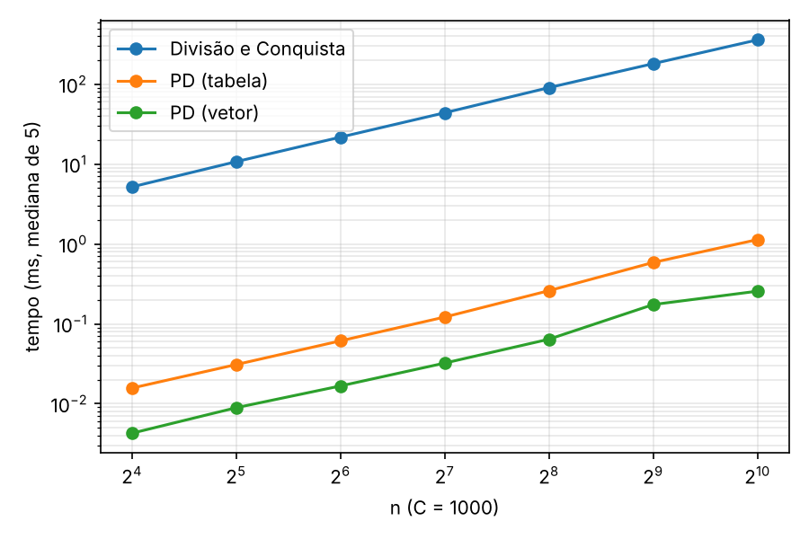
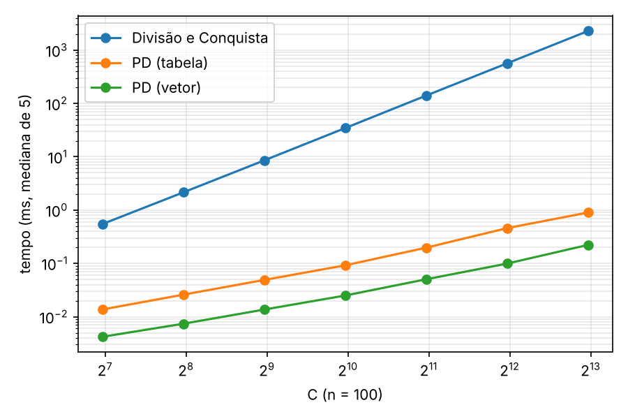
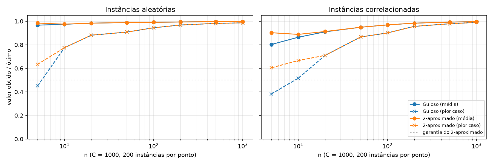

# Trabalho Final de APA: Implementação e Análise de Estratégias de Algoritmos para Solução de Problema NP

## Mochila Binária (0-1 Knapsack)

---

## 1. Autores

| Nome completo | Matrícula | Estratégias |
|---|---|---|
| `BRUNO FERREIRA SILVA` | `202503283` | Força Bruta e Backtracking |
| `TIAGO SALES RIBEIRO` | `202503313` | Algoritmo Guloso e Algoritmo Aproximado/Heurística |
| `VICTOR RANGEL TASSE MAGALHÃES` | `202503314` | Divisão e Conquista e Programação Dinâmica |

---

## 2. Introdução

### 2.1 Descrição do problema

Uma mochila suporta peso total de no máximo $C$. Há $n$ itens disponíveis: o item $i$ tem peso $p_i$ e valor $v_i$, e cada um pode ser levado inteiro ou deixado de fora. Não é possível fracionar um item nem levar duas cópias dele, daí o nome "0-1". A pergunta é se existe uma escolha de itens que caiba na mochila e cujo valor total atinja pelo menos uma meta $V$.

**Versão de decisão (o problema sorteado).** Dada uma instância $I = (\{(p_i, v_i)\}_{i=1}^{n},\ C,\ V)$, com $p_i, v_i, C, V \in \mathbb{Z}_{\geq 0}$, existe $S \subseteq \{1,\dots,n\}$ tal que

$$\sum_{i \in S} p_i \leq C \quad\text{e}\quad \sum_{i \in S} v_i \geq V\,?$$

De forma equivalente, existe $x \in \{0,1\}^n$ com $\sum_i p_i x_i \le C$ e $\sum_i v_i x_i \ge V$.

**Versão de otimização.** Calcular

$$\mathrm{OPT}(I) = \max\Big\{\sum_{i\in S} v_i \;:\; S \subseteq \{1,\dots,n\},\ \sum_{i\in S} p_i \leq C\Big\}.$$

Resolver a otimização resolve a decisão: a resposta é **SIM** se, e somente se, $\mathrm{OPT}(I) \geq V$. As estratégias deste trabalho seguem esse caminho.

**Tamanho da entrada.** Com os inteiros codificados em binário, a instância ocupa

$$|I| = \Theta\big(n \cdot \log_2(\max_i\{p_i, v_i\}) + \log_2 C + \log_2 V\big) \text{ bits}.$$

Essa medida é a referência para dizer se um algoritmo é polinomial (Seções 3 e 5.5).

### 2.2 Aplicações práticas

O modelo aparece sempre que é preciso escolher um subconjunto de itens indivisíveis sob um único orçamento [6]:

- **Seleção de projetos e orçamento de capital.** Cada projeto tem um custo (peso) e um retorno esperado (valor), e o orçamento é $C$.
- **Carregamento de carga.** Cada volume, contêiner ou pacote tem um peso e um valor de frete, e o veículo tem capacidade $C$.
- **Alocação de recursos computacionais.** Cada tarefa ou serviço consome memória ou CPU e traz um benefício, e o servidor tem limite $C$.
- **Montagem de contexto em sistemas com LLM (RAG).** Cada trecho recuperado custa um número de tokens e tem uma pontuação de relevância, e a janela de contexto tem $C$ tokens.
- **Criptografia.** O criptossistema de Merkle–Hellman se baseou na dificuldade de uma variante da mochila (soma de subconjuntos) [7]. Ele foi quebrado depois, e o caso ilustra por que "NP-difícil no pior caso" não garante instâncias difíceis na prática.

Por ser NP-completo (Seção 3.6), o problema não tem algoritmo polinomial conhecido. Por isso faz sentido comparar estratégias de projeto de algoritmos diferentes: exatas exponenciais, exatas pseudo-polinomiais e aproximadas.

### 2.3 Organização

A Seção 3 prova que o problema pertence a NP. As Seções 4 a 6 descrevem as implementações, a complexidade de cada uma e os resultados experimentais. A Seção 7 conclui o trabalho.

---

## 3. Prova de que o problema pertence à classe NP

### 3.1 Definição utilizada

Segundo [1, seç. 34.2], uma linguagem $L$ pertence a **NP** se, e somente se, existem um algoritmo verificador $A$ de tempo polinomial e uma constante $k$ tais que

$$L = \{\, x \in \{0,1\}^* : \exists\, y,\ |y| = O(|x|^k),\ A(x, y) = 1 \,\}.$$

A cadeia $y$ é o **certificado**. O verificador não precisa encontrar a solução, apenas conferir em tempo polinomial uma solução proposta.

Seja $\text{MOCHILA-01} = \{\langle I \rangle : I \text{ é instância com resposta SIM}\}$.

### 3.2 Certificado

O certificado é o conjunto $S$ dos itens escolhidos, codificado como o vetor característico $y \in \{0,1\}^n$ (ou como a lista dos índices escolhidos). Logo $|y| \le n \le |I|$, e o tamanho do certificado é polinomial (linear) no tamanho da entrada.

### 3.3 Verificador

```
VERIFICA-MOCHILA(I, y):
1  se |y| ≠ n: rejeita
2  P ← 0;  W ← 0
3  para i ← 1 até n:
4      se y_i = 1:
5          P ← P + p_i
6          W ← W + v_i
7  se P ≤ C e W ≥ V: aceita
8  senão: rejeita
```

A implementação usada no trabalho recebe a lista de índices. Ela também rejeita índices repetidos, o que garante a restrição "0-1":

```cpp
bool verificarCertificado(const Instancia& instancia, const std::vector<int>& selecionados) {
    const std::size_t n = instancia.itens.size();
    std::vector<bool> usado(n, false);
    long long pesoTotal = 0;
    Valor valorTotal = 0;
    for (int indice : selecionados) {
        if (indice < 0 || paraIndice(indice) >= n || usado[paraIndice(indice)]) {
            return false;  // índice inválido ou item repetido (viola o "0-1")
        }
        const std::size_t i = paraIndice(indice);
        usado[i] = true;
        pesoTotal += instancia.itens[i].peso;
        valorTotal += instancia.itens[i].valor;
    }
    return pesoTotal <= instancia.capacidade && valorTotal >= instancia.alvo;
}
```

### 3.4 O verificador executa em tempo polinomial

- O laço das linhas 3–6 executa $n$ iterações, cada uma com um número constante de comparações e somas.
- As somas $P$ e $W$ não passam de $n \cdot \max_i\{p_i, v_i\}$, então têm $O(\log n + \log \max_i\{p_i, v_i\})$ bits. Cada soma ou comparação custa tempo linear nesse número de bits, o que é $O(|I|)$.
- As comparações da linha 7 custam $O(\log C + \log V + \log n + \log\max_i\{p_i,v_i\}) = O(|I|)$.

Portanto, o tempo total é $O(n \cdot |I|) = O(|I|^2)$, que é polinomial no tamanho da entrada. Contando as operações aritméticas como $O(1)$, como no restante do trabalho, o custo é $\Theta(n)$.

### 3.5 Corretude do verificador

- **Completude.** Se $\langle I \rangle \in \text{MOCHILA-01}$, existe $S$ com $\sum_{S} p_i \le C$ e $\sum_{S} v_i \ge V$. O vetor característico $y$ de $S$ faz o verificador calcular $P = \sum_{S} p_i \le C$ e $W = \sum_{S} v_i \ge V$, e ele aceita.
- **Consistência.** Se o verificador aceita $(I, y)$, o conjunto $S = \{i : y_i = 1\}$ satisfaz as duas restrições, porque são exatamente as condições testadas na linha 7. Então $\langle I \rangle \in \text{MOCHILA-01}$. Se a instância é NÃO, nenhum $y$ é aceito.

Pelas Seções 3.2 a 3.5 e pela definição da Seção 3.1, **MOCHILA-01 ∈ NP**. $\blacksquare$

### 3.6 Complemento: MOCHILA-01 é NP-completo

O enunciado pede apenas a pertinência a NP, mas a NP-dificuldade justifica a comparação entre estratégias. O problema está entre os 21 problemas NP-completos de Karp [5]. Uma redução direta parte da **Soma de Subconjuntos**, que é NP-completa [1, seç. 34.5.5]:

- Dada uma instância $(\{s_1,\dots,s_n\}, t)$ de Soma de Subconjuntos, construa a instância de mochila com $p_i = v_i = s_i$ e $C = V = t$. A construção leva tempo $O(n)$.
- Para qualquer $S$, vale $\sum_S s_i \le t$ e $\sum_S s_i \ge t$ se, e somente se, $\sum_S s_i = t$. As duas instâncias têm, portanto, a mesma resposta.

Assim, $\text{SOMA-SUBCONJ} \le_p \text{MOCHILA-01}$, e o problema é NP-difícil. Somado à Seção 3.5, ele é **NP-completo**.

---

## 4. Implementação

### 4.1 Organização do código

| Arquivo | Responsabilidade |
|---|---|
| `include/mochila.hpp` | Tipos (`Item`, `Instancia`, `Resultado`) e contratos de todas as estratégias |
| `src/mochila.cpp` | Leitura de instância, gerador aleatório reprodutível, verificador de certificado |
| `src/divisao_conquista.cpp` | Estratégia D&C |
| `src/programacao_dinamica.cpp` | Estratégia PD (tabela completa e vetor único) |
| `src/guloso.cpp` | Heurística gulosa por densidade $v_i/p_i$ |
| `src/aproximado.cpp` | Algoritmo 2-aproximado (guloso modificado) |
| `src/main.cpp` | Execução de uma instância, benchmark (tempo + contagem de operações) e experimento de qualidade das heurísticas |
| `scripts/graficos.py` | Geração dos gráficos a partir dos CSVs |

Linguagem: C++17, compilado com `g++ -O2`. Formato de entrada:

```
n C V
p_1 v_1
...
p_n v_n
```

Cada estratégia devolve um `Resultado` com o melhor valor, a resposta da decisão, o certificado (quando reconstruído) e o número de execuções da **operação barômetro**, usada na análise por contagem de instruções [2].

### 4.2 Divisão e Conquista

A divisão é feita sobre o **conjunto de itens**. Para um subconjunto de itens $X$, define-se o perfil

$$f_X(c) = \max\Big\{\sum_{i\in S} v_i : S \subseteq X,\ \sum_{i\in S} p_i \leq c\Big\}, \qquad c = 0,\dots,C.$$

- **Dividir:** o intervalo de itens $[\text{ini}, \text{fim})$ é partido ao meio em $X_E$ e $X_D$.
- **Conquistar:** calcula-se recursivamente $f_{X_E}$ e $f_{X_D}$. O caso base é um único item: $f_{\{i\}}(c) = v_i$ se $p_i \leq c$, e $0$ caso contrário.
- **Combinar:** como $X_E \cap X_D = \emptyset$, toda solução de $X_E \cup X_D$ é a união de uma solução de cada metade, que dividem a capacidade entre si:

$$f_{X_E \cup X_D}(c) = \max_{0 \leq a \leq c}\ \big(f_{X_E}(a) + f_{X_D}(c-a)\big).$$

Essa operação é uma convolução $(\max, +)$. A resposta final é $f_{\{1..n\}}(C)$.

Os subproblemas $X_E$ e $X_D$ são **disjuntos e independentes**: nenhum perfil é calculado duas vezes. Essa é a característica de D&C que o separa da PD, cujos subproblemas se sobrepõem [1, cap. 4 e 15].

```cpp
/** @brief Caso base: um único item cabe (valor) ou não cabe (0) em cada capacidade. */
Perfil resolverItemUnico(const Item& item, std::size_t capacidade, Contador& operacoes) {
    const std::size_t peso = paraIndice(item.peso);
    Perfil perfil(capacidade + 1, 0);
    for (std::size_t c = 0; c <= capacidade; ++c) {
        ++operacoes;
        perfil[c] = (peso <= c) ? item.valor : 0;
    }
    return perfil;
}

/** @brief Combina dois perfis disjuntos por convolução (max, +). Custo (C+1)(C+2)/2. */
Perfil combinar(const Perfil& esquerda, const Perfil& direita, std::size_t capacidade, Contador& operacoes) {
    Perfil combinado(capacidade + 1, 0);
    for (std::size_t c = 0; c <= capacidade; ++c) {
        Valor melhor = 0;
        for (std::size_t a = 0; a <= c; ++a) {
            ++operacoes;
            melhor = std::max(melhor, esquerda[a] + direita[c - a]);
        }
        combinado[c] = melhor;
    }
    return combinado;
}

/** @brief Resolve o subconjunto de itens [inicio, fim), com fim - inicio ≥ 1. */
Perfil resolverIntervalo(const std::vector<Item>& itens, std::size_t inicio, std::size_t fim,
                         std::size_t capacidade, Contador& operacoes) {
    if (fim - inicio == 1) {
        return resolverItemUnico(itens[inicio], capacidade, operacoes);
    }
    const std::size_t meio = inicio + (fim - inicio) / 2;
    const Perfil esquerda = resolverIntervalo(itens, inicio, meio, capacidade, operacoes);
    const Perfil direita = resolverIntervalo(itens, meio, fim, capacidade, operacoes);
    return combinar(esquerda, direita, capacidade, operacoes);
}

Resultado resolverDivisaoConquista(const Instancia& instancia) {
    Resultado resultado;
    if (!instancia.itens.empty()) {
        const std::size_t capacidade = paraIndice(instancia.capacidade);
        const Perfil perfil = resolverIntervalo(instancia.itens, 0, instancia.itens.size(),
                                                capacidade, resultado.operacoes);
        resultado.melhorValor = perfil[capacidade];
    }
    resultado.atingeAlvo = resultado.melhorValor >= instancia.alvo;
    return resultado;
}
```

**Corretude (esboço).** Por indução no tamanho de $X$. O caso base é imediato. No passo, seja $S^*$ ótimo para $(X_E \cup X_D, c)$ e $a^* = \sum_{i \in S^*\cap X_E} p_i$. Então $S^* \cap X_E$ é viável para $(X_E, a^*)$ e $S^* \cap X_D$ para $(X_D, c-a^*)$, logo o termo $a = a^*$ da combinação vale pelo menos $\mathrm{OPT}$. Reciprocamente, todo termo da combinação corresponde a uma solução viável. Portanto o máximo é exatamente $f_{X_E\cup X_D}(c)$.

### 4.3 Programação Dinâmica

Seja $M[i][c]$ o maior valor usando apenas os $i$ primeiros itens com capacidade $c$. Vale a **subestrutura ótima**: na solução ótima, o item $i$ fica de fora (resta o subproblema $(i-1, c)$) ou entra (resta $(i-1, c-p_i)$). A recorrência é

$$
M[i][c] =
\begin{cases}
0 & i = 0 \\
M[i-1][c] & i \geq 1,\ p_i > c \\
\max\big(M[i-1][c],\ M[i-1][c-p_i] + v_i\big) & i \geq 1,\ p_i \leq c
\end{cases}
$$

Avaliada recursivamente sem memória, essa recorrência faz até $2^n$ chamadas e recalcula os mesmos pares $(i, c)$ muitas vezes (**subproblemas sobrepostos**). Como só existem $(n+1)(C+1)$ pares distintos, a PD preenche a tabela de baixo para cima e calcula cada um uma única vez [1, cap. 15; 4, seç. 6.4].

Foram implementadas duas variantes:

- **Tabela completa** $(n+1)\times(C+1)$: permite reconstruir os itens escolhidos, ou seja, devolve o certificado da resposta SIM.
- **Vetor único** de tamanho $C+1$: percorre $c$ em ordem decrescente, de modo que $M[c - p_i]$ ainda contém o valor da linha anterior e cada item é usado no máximo uma vez. Economiza memória, mas não reconstrói a solução.

```cpp
Resultado resolverProgramacaoDinamica(const Instancia& instancia) {
    const std::vector<Item>& itens = instancia.itens;
    const std::size_t n = itens.size();
    const std::size_t capacidade = paraIndice(instancia.capacidade);
    Tabela tabela(n + 1, capacidade + 1);  // linha 0 já é zero

    Resultado resultado;
    for (std::size_t i = 1; i <= n; ++i) {                                    // linha 1
        const std::size_t peso = paraIndice(itens[i - 1].peso);
        const Valor valor = itens[i - 1].valor;
        for (std::size_t c = 0; c <= capacidade; ++c) {                       // linha 2
            ++resultado.operacoes;
            tabela.em(i, c) = tabela.em(i - 1, c);                            // linha 3: não leva
            if (peso <= c) {                                                  // linha 4
                tabela.em(i, c) = std::max(tabela.em(i, c),                   // linha 5: leva
                                           tabela.em(i - 1, c - peso) + valor);
            }
        }
    }

    resultado.melhorValor = tabela.em(n, capacidade);
    resultado.atingeAlvo = resultado.melhorValor >= instancia.alvo;
    resultado.selecionados = reconstruirSolucao(tabela, itens, capacidade);
    return resultado;
}

/** @brief Percorre a tabela de trás para frente e recupera os itens escolhidos. O(n). */
std::vector<int> reconstruirSolucao(const Tabela& tabela, const std::vector<Item>& itens, std::size_t capacidade) {
    std::vector<int> selecionados;
    std::size_t c = capacidade;
    for (std::size_t i = itens.size(); i >= 1; --i) {
        if (tabela.em(i, c) != tabela.em(i - 1, c)) {  // valor mudou ⇒ item i foi usado
            selecionados.push_back(static_cast<int>(i - 1));
            c -= paraIndice(itens[i - 1].peso);        // seguro: o item só foi usado se coube em c
        }
    }
    std::reverse(selecionados.begin(), selecionados.end());
    return selecionados;
}

Resultado resolverProgramacaoDinamicaVetor(const Instancia& instancia) {
    const std::size_t capacidade = paraIndice(instancia.capacidade);
    std::vector<Valor> melhor(capacidade + 1, 0);

    Resultado resultado;
    for (const Item& item : instancia.itens) {
        const std::size_t peso = paraIndice(item.peso);
        // Ordem decrescente de c: melhor[c - peso] ainda é da "linha anterior",
        // garantindo que cada item seja usado no máximo uma vez.
        // "c-- > peso" percorre c = C, C-1, ..., peso sem underflow do size_t (inclusive com peso 0).
        for (std::size_t c = capacidade + 1; c-- > peso;) {
            ++resultado.operacoes;
            melhor[c] = std::max(melhor[c], melhor[c - peso] + item.valor);
        }
    }

    resultado.melhorValor = melhor[capacidade];
    resultado.atingeAlvo = resultado.melhorValor >= instancia.alvo;
    return resultado;
}
```

A tabela é guardada em um `std::vector` contíguo, indexado por `i * (C+1) + c`, para manter a localidade de cache no laço interno.

### 4.4 Algoritmo Guloso

Um algoritmo guloso constrói a solução em passos, tomando em cada um a escolha que parece melhor no momento e sem nunca desfazê-la [1, cap. 16]. Para a mochila, o critério natural é a **densidade** $d_i = v_i / p_i$, o valor por unidade de peso: os itens mais "rentáveis" entram primeiro.

```
GULOSO(I):
1  descarta os itens com v_i = 0               ▹ nunca melhoram a solução
2  S ← itens com p_i = 0                       ▹ densidade infinita: entram sempre
3  L ← demais itens, em ordem decrescente de v_i / p_i
4  R ← C                                       ▹ capacidade restante
5  para cada item i de L, nessa ordem:
6      se p_i ≤ R:
7          S ← S ∪ {i};  R ← R − p_i
8  devolve S
```

Dois detalhes da implementação merecem nota:

- **Comparação sem ponto flutuante.** Para $p_i, p_j > 0$, vale $v_i/p_i > v_j/p_j \iff v_i\,p_j > v_j\,p_i$. O produto cruzado é feito em inteiros de 128 bits (`__int128`, extensão do GCC), então é exato para qualquer valor de 64 bits e qualquer peso de 32 bits aceitos na entrada. Empates são desfeitos pelo índice, então a ordem é total e o resultado é determinístico.
- **A varredura não para no primeiro item que não cabe.** Um item mais adiante, de densidade menor, pode ser leve o bastante para ocupar a capacidade que sobrou. Isso nunca piora a solução em relação a parar.

```cpp
std::sort(candidatos.begin(), candidatos.end(), [&itens, &operacoes](int a, int b) {
    ++operacoes;
    const Item& x = itens[paraIndice(a)];
    const Item& y = itens[paraIndice(b)];
    const Valor esquerda = x.valor * y.peso;
    const Valor direita = y.valor * x.peso;
    if (esquerda != direita) return esquerda > direita;
    return a < b;
});

long long restante = instancia.capacidade;
for (int i : pesoZero) {
    resultado.selecionados.push_back(i);
    resultado.melhorValor += itens[paraIndice(i)].valor;
}
for (int i : candidatos) {
    ++resultado.operacoes;
    const Item& item = itens[paraIndice(i)];
    if (item.peso <= restante) {
        restante -= item.peso;
        resultado.melhorValor += item.valor;
        resultado.selecionados.push_back(i);
    }
}
```

**O guloso é ótimo para a versão fracionária, mas não para a 0-1.** Se fosse permitido levar uma fração do item, completar a mochila com a fração do primeiro item que não cabe seria ótimo [1, seç. 16.2; 8]. Na versão 0-1 essa fração é perdida, e a perda pode ser arbitrariamente grande. Na instância `data/guloso_ruim.txt`, com $C = 100$:

| Item | $p_i$ | $v_i$ | $v_i/p_i$ |
|---:|---:|---:|---:|
| 1 | 1 | 2 | 2,0 |
| 2 | 100 | 100 | 1,0 |

O guloso leva o item 1 (maior densidade), sobra capacidade 99 e o item 2 não cabe mais: o valor obtido é 2. O ótimo é levar só o item 2, com valor 100. Trocando 100 por $C$, a razão entre o guloso e o ótimo é $2/C$, que tende a zero. Portanto, o guloso puro é uma **heurística sem garantia de qualidade**.

### 4.5 Algoritmo Aproximado (2-aproximação)

Seguindo [1, cap. 35], um algoritmo de tempo polinomial tem **razão de aproximação $\rho \ge 1$** para um problema de maximização se, para toda instância, devolve uma solução viável de valor $A$ com $\mathrm{OPT}/A \le \rho$, isto é, $A \ge \mathrm{OPT}/\rho$. Ele é chamado de **$\rho$-aproximação**. Uma 2-aproximação garante, portanto, pelo menos metade do ótimo [10]. O pior caso da Seção 4.4 mostra o que falta ao guloso: um item pequeno e denso "rouba" a capacidade de um item grande e valioso. A correção é comparar a solução gulosa com a melhor solução formada por **um único item** [6, cap. 2]:

```
APROXIMADO(I):
1  S_g ← GULOSO(I)
2  j ← item de maior v_j entre os que têm p_j ≤ C
3  se v_j > valor(S_g): devolve {j}
4  senão: devolve S_g
```

```cpp
Resultado resolverAproximado(const Instancia& instancia) {
    Resultado resultado = resolverGuloso(instancia);

    // (b) item mais valioso que cabe sozinho.
    int melhorItem = -1;
    for (std::size_t i = 0; i < instancia.itens.size(); ++i) {
        ++resultado.operacoes;
        const Item& item = instancia.itens[i];
        if (item.peso <= instancia.capacidade &&
            (melhorItem < 0 || item.valor > instancia.itens[paraIndice(melhorItem)].valor)) {
            melhorItem = static_cast<int>(i);
        }
    }

    if (melhorItem >= 0 && instancia.itens[paraIndice(melhorItem)].valor > resultado.melhorValor) {
        resultado.melhorValor = instancia.itens[paraIndice(melhorItem)].valor;
        resultado.selecionados = {melhorItem};
    }

    resultado.atingeAlvo = resultado.melhorValor >= instancia.alvo;
    return resultado;
}
```

**Teorema.** APROXIMADO devolve uma solução viável de valor $A \ge \mathrm{OPT}/2$.

*Prova.* A viabilidade é imediata: as duas candidatas cabem na mochila. Itens com $p_i > C$ não fazem parte de nenhuma solução viável, então podem ser ignorados sem alterar $\mathrm{OPT}$ (o guloso também os pula). Se o guloso leva todos os itens restantes, ele é ótimo e não há o que provar. Caso contrário, ordene os itens por densidade decrescente e seja $k$ o primeiro que o guloso não consegue levar. Até ele, o guloso levou os itens $1, \dots, k-1$, e $p_1 + \dots + p_k > C$.

O ótimo da versão fracionária, $\mathrm{OPT}_f$, leva os itens $1..k-1$ inteiros e uma fração do item $k$ [1, seç. 16.2]. Toda solução 0-1 também é uma solução fracionária, então

$$\mathrm{OPT} \;\le\; \mathrm{OPT}_f \;\le\; \sum_{i=1}^{k-1} v_i + v_k.$$

O guloso vale pelo menos $\sum_{i=1}^{k-1} v_i$, e o item mais valioso que cabe sozinho vale pelo menos $v_k$, pois $p_k \le C$. Logo

$$\mathrm{OPT} \;\le\; \mathrm{guloso} + v_j \;\le\; 2 \max(\mathrm{guloso},\ v_j) \;=\; 2A. \qquad \blacksquare$$

**A garantia é justa.** Na instância `data/aproximado_justo.txt`, com $C = 100$, os itens são $(1, 2)$, $(50, 50)$ e $(50, 50)$. O guloso leva o item de densidade 2 e um dos itens de peso 50, totalizando 52. O melhor item sozinho vale 50, então $A = 52$. O ótimo leva os dois itens de peso 50 e vale 100. Generalizando para $C$ par, com itens $(1, 2)$, $(C/2, C/2)$ e $(C/2, C/2)$, obtém-se $A = C/2 + 2$ e $\mathrm{OPT} = C$, e a razão tende a $1/2$. Nenhuma análise melhor que $1/2$ vale para este algoritmo.

### 4.6 Heurísticas e a versão de decisão

O driver trata as estratégias exatas e as heurísticas de forma diferente:

- **Resposta SIM é sempre correta.** A solução devolvida é viável, e se o valor dela atinge $V$, ela é um certificado aceito pelo verificador da Seção 3.3.
- **Resposta NÃO não pode ser dada pelo guloso.** Não ter encontrado uma solução com valor $\ge V$ não prova que ela não existe. Nesse caso o programa responde `NAO SEI`.
- **O aproximado consegue certificar parte das respostas NÃO.** Pelo teorema, $\mathrm{OPT} \le 2A$. Se $2A < V$, então $\mathrm{OPT} < V$ e a resposta é NÃO com certeza. Só a faixa $V/2 \le A < V$ fica indefinida.

No benchmark, as estratégias exatas precisam devolver o mesmo valor que a PD. As heurísticas são conferidas de outra forma: a solução precisa ser viável, seu valor tem de ser no máximo $\mathrm{OPT}$, e o aproximado tem de respeitar $A \ge \mathrm{OPT}/2$. Uma violação interrompe o experimento com erro.

---

## 5. Análise de Complexidade

O tamanho da entrada é medido por $n$ (número de itens) e $C$ (capacidade). A contagem segue o método da operação barômetro [2]: em cada estratégia, conta-se a instrução executada no laço mais interno, que domina o custo assintótico.

### 5.1 Divisão e Conquista

**Barômetro:** uma avaliação de candidato, isto é, uma atribuição no caso base ou um par soma+comparação na combinação.

- Caso base (folha): $C+1$ operações.
- Combinação: para cada $c$, o laço interno roda $c+1$ vezes, logo $\sum_{c=0}^{C}(c+1) = \frac{(C+1)(C+2)}{2}$ operações.

**Recorrência:**

$$
T(n) =
\begin{cases}
C+1 & n = 1 \\
T(\lceil n/2 \rceil) + T(\lfloor n/2 \rfloor) + \frac{(C+1)(C+2)}{2} & n \geq 2
\end{cases}
$$

A árvore de recursão é binária e cheia, com $n$ folhas e exatamente $n-1$ nós internos, cada um fazendo uma combinação. Assim, a contagem exata (para $n \ge 1$) é

$$\boxed{T(n, C) = n\,(C+1) + (n-1)\,\frac{(C+1)(C+2)}{2} = \Theta(n\,C^2)}$$

Pelo Teorema Mestre [1, seç. 4.5], tomando $C$ fixo: $a = 2$, $b = 2$, $f(n) = \Theta(C^2) = O(n^{\log_2 2 - \varepsilon})$ (caso 1), logo $T(n) = \Theta(n)$ em $n$. Mantendo o fator de $C$, obtém-se $\Theta(nC^2)$.

**Espaço:** a recursão tem profundidade $\lceil \log_2 n \rceil$. Cada quadro ativo mantém no máximo dois perfis de tamanho $C+1$, logo o espaço é $\Theta(C \log n)$, além da entrada.

### 5.2 Programação Dinâmica (tabela)

Análise linha a linha no estilo de [1, cap. 2], com $c_k$ o custo constante da linha $k$ do código da Seção 4.3:

| Linha | Instrução | Custo | Execuções |
|---|---|---|---|
| 1 | `for i = 1..n` | $c_1$ | $n+1$ |
| 2 | `for c = 0..C` | $c_2$ | $n(C+2)$ |
| 3 | `M[i][c] = M[i-1][c]` | $c_3$ | $n(C+1)$ |
| 4 | `if p_i <= c` | $c_4$ | $n(C+1)$ |
| 5 | `M[i][c] = max(...)` | $c_5$ | $\sum_{i=1}^{n}\max(0,\ C-p_i+1) \leq n(C+1)$ |

$$T(n,C) = c_1(n+1) + c_2\,n(C+2) + (c_3 + c_4)\,n(C+1) + c_5\sum_{i=1}^{n}\max(0, C-p_i+1) = \Theta(n\,C)$$

**Barômetro** (uma célula calculada): exatamente $n(C+1)$.

**Reconstrução:** $\Theta(n)$. **Espaço:** $\Theta(nC)$ para a tabela.

### 5.3 Programação Dinâmica (vetor)

O laço interno roda $C - p_i + 1$ vezes para cada item com $p_i \leq C$:

$$T(n,C) = \sum_{i=1}^{n} \max(0,\ C - p_i + 1) = O(n\,C).$$

Com $p_i \sim \mathcal{U}\{1,\dots,C\}$, como no gerador do benchmark, $\mathbb{E}[T] = n\,\frac{C+1}{2}$. **Espaço:** $\Theta(C)$.

### 5.4 Por que D&C perde para PD neste problema

As duas abordagens exploram a mesma estrutura (a capacidade discretizada em $C+1$ valores), mas combinam os subproblemas de formas diferentes:

- A **PD** acrescenta **um item** por vez. Juntar um único item a um perfil custa $\Theta(C)$, porque para cada $c$ só há duas escolhas: levar ou não levar.
- A **D&C** junta **dois conjuntos arbitrários** de itens. Para cada $c$ é preciso testar todas as $c+1$ divisões da capacidade, o que dá $\Theta(C^2)$ por combinação.

Como há $\Theta(n)$ combinações em ambos os casos, a razão entre os custos é $\Theta(C)$. Pela contagem exata, $T_{DC}/T_{PD} = 1 + \frac{n-1}{n}\cdot\frac{C+2}{2} \to \frac{C+4}{2}$ quando $n$ cresce.

### 5.5 Pseudo-polinomialidade

$\Theta(nC)$ **não** é polinomial no tamanho da entrada. Com $C$ codificado em binário, a entrada tem $\Theta(n \log \max(p_i, v_i) + \log C)$ bits, e $C = 2^{\log_2 C}$ é exponencial nesse tamanho. Por isso as duas estratégias são **pseudo-polinomiais**. Isso é coerente com a NP-completude da mochila 0-1: o problema é NP-completo apenas no sentido fraco e admite algoritmo polinomial quando os números estão codificados em unário [3]. Na prática, a PD é a melhor escolha quando $C$ é moderado; para capacidades grandes (por exemplo, pesos em gramas com $C$ da ordem de $10^9$), ela se torna inviável, e entram as estratégias exponenciais ou aproximadas.

### 5.6 Algoritmo Guloso

**Barômetro:** uma comparação entre dois itens na ordenação ou a inspeção de um item (no filtro das linhas 1–2 ou na varredura das linhas 5–7).

| Etapa | Execuções do barômetro |
|---|---|
| Filtro (linhas 1–2) | $n$ |
| Ordenação (linha 3) | $K(n) = O(n \log n)$ comparações |
| Varredura (linhas 5–7) | $m \le n$, onde $m$ é o número de itens com $p_i > 0$ e $v_i > 0$ |

$$T(n) = n + K(n) + m = \Theta(n \log n).$$

A ordenação usa `std::sort`, que desde o C++11 tem garantia de $O(n \log n)$ comparações também no pior caso (é um *introsort*). O limite inferior $\Omega(n \log n)$ para ordenação por comparação [1, seç. 8.1] mostra que essa etapa domina o custo. As outras etapas são lineares. Nas instâncias do benchmark, a constante medida ficou entre $1{,}16$ e $1{,}30$, isto é, $K(n) \approx 1{,}2\, n \log_2 n$ (Seção 6.5).

O custo **não depende de $C$**: a capacidade só aparece na comparação $p_i \le R$. Essa é a diferença essencial em relação às estratégias das Seções 5.1 a 5.3. O algoritmo é **polinomial no tamanho da entrada**, e não apenas pseudo-polinomial (Seção 5.5).

**Espaço:** $\Theta(n)$ para o vetor de índices ordenado e para a solução.

### 5.7 Algoritmo Aproximado

O algoritmo executa o guloso e depois uma busca linear pelo item mais valioso que cabe, com uma inspeção por item:

$$T(n) = T_{\text{guloso}}(n) + n = \Theta(n \log n).$$

O valor medido é sempre exatamente o do guloso mais $n$ (Seção 6.5). **Espaço:** $\Theta(n)$.

O custo adicional em relação ao guloso é desprezível e compra uma garantia de pior caso que o guloso não tem. Ainda assim, $1/2$ é uma garantia fraca. Existem esquemas de aproximação totalmente polinomiais (FPTAS) que obtêm $(1-\varepsilon)\,\mathrm{OPT}$ em tempo $O(n^3/\varepsilon)$, arredondando os valores e aplicando uma PD sobre eles [10, cap. 8]. Eles ficaram fora do escopo deste trabalho.

### 5.8 Resumo

| Estratégia | Tempo | Espaço | Barômetro exato | Certificado | Qualidade |
|---|---|---|---|---|---|
| D&C | $\Theta(nC^2)$ | $\Theta(C\log n)$ | $n(C+1) + (n-1)\frac{(C+1)(C+2)}{2}$ | Não | Ótimo |
| PD (tabela) | $\Theta(nC)$ | $\Theta(nC)$ | $n(C+1)$ | Sim, em $\Theta(n)$ | Ótimo |
| PD (vetor) | $O(nC)$ | $\Theta(C)$ | $\sum_i \max(0, C-p_i+1)$ | Não | Ótimo |
| Guloso | $\Theta(n \log n)$ | $\Theta(n)$ | $n + K(n) + m$ | Sim | Sem garantia |
| Aproximado | $\Theta(n \log n)$ | $\Theta(n)$ | $2n + K(n) + m$ | Sim | $\ge \mathrm{OPT}/2$ |

---

## 6. Análise de Resultados

### 6.1 Metodologia

- Instâncias aleatórias com semente fixa (42): $p_i \sim \mathcal{U}\{1..C\}$, $v_i \sim \mathcal{U}\{1..1000\}$, $V = \lfloor \sum v_i / 2 \rfloor$.
- Experimento A: $n \in \{16, 32, \dots, 1024\}$ com $C = 1000$.
- Experimento B: $C \in \{125, 250, \dots, 8000\}$ com $n = 100$.
- Tempo medido com `std::chrono::steady_clock`, reportando a mediana de 5 execuções.
- Ambiente: Intel Xeon @ 2,10 GHz, g++ 13.3, `-O2`, Linux. *(Os valores absolutos devem ser refeitos na máquina usada na apresentação com a task "Benchmark + gráficos" do VS Code ou `make benchmark`; as razões entre eles não devem mudar.)*
- Em todas as 28 medições com fórmula fechada, a contagem medida bateu exatamente com a fórmula da Seção 5.
- As heurísticas (Seções 6.5 e 6.6) foram medidas em outro ambiente: Intel Core i5-12450H, g++ 13.3, `-O2`, Ubuntu no WSL2. Para comparar com elas, a PD vetor foi medida de novo na mesma execução. Esses dados estão em `results/resultados_heuristicas.csv`, separados de `results/resultados.csv`, que contém as medições das Seções 6.2 a 6.4.
- Experimento C, de qualidade das heurísticas: para cada $n \in \{5, 10, 20, 50, 100, 200, 500, 1000\}$, com $C = 1000$, foram geradas 200 instâncias (sementes 0 a 199) em duas famílias:
  - **aleatória**, igual à dos experimentos A e B;
  - **fortemente correlacionada**, com $v_i = p_i + C/10$. É uma família clássica de instâncias difíceis [9]: as densidades ficam todas próximas de 1, e o critério guloso quase não distingue os itens.
- No experimento C, o ótimo de cada instância foi calculado pela PD vetor. Para cada heurística, registrou-se a razão $A/\mathrm{OPT}$ (mínima e média) e a fração de instâncias resolvidas no ótimo. São 3.200 instâncias, e o experimento leva cerca de 0,3 s.

### 6.2 Experimento A: variando $n$ ($C = 1000$)

| $n$ | D&C (ms) | D&C (ops) | PD tabela (ms) | PD tabela (ops) | PD vetor (ms) | PD vetor (ops) |
|---:|---:|---:|---:|---:|---:|---:|
| 16 | 5,18 | 7.538.531 | 0,016 | 16.016 | 0,004 | 8.406 |
| 32 | 10,72 | 15.578.563 | 0,031 | 32.032 | 0,009 | 18.079 |
| 64 | 21,74 | 31.658.627 | 0,061 | 64.064 | 0,017 | 34.136 |
| 128 | 43,88 | 63.818.755 | 0,122 | 128.128 | 0,032 | 66.345 |
| 256 | 90,63 | 128.139.011 | 0,260 | 256.256 | 0,064 | 130.949 |
| 512 | 180,83 | 256.779.523 | 0,587 | 512.512 | 0,174 | 255.325 |
| 1024 | 358,78 | 514.060.547 | 1,134 | 1.025.024 | 0,256 | 519.757 |



Ao dobrar $n$, o tempo das três estratégias dobra (razões entre 1,98 e 2,07 na D&C), como esperado para custo linear em $n$. No gráfico log-log, as retas são paralelas e têm inclinação 1. A distância vertical entre D&C e PD tabela é constante. Em operações, a razão é $\approx 502 = (C+4)/2$, como previsto na Seção 5.4. Em tempo, ela é menor (cerca de $316\times$), porque cada operação da D&C é mais barata (Seção 6.4).

### 6.3 Experimento B: variando $C$ ($n = 100$)

| $C$ | D&C (ms) | D&C (ops) | PD tabela (ms) | PD tabela (ops) | PD vetor (ms) | PD vetor (ops) |
|---:|---:|---:|---:|---:|---:|---:|
| 125 | 0,55 | 804.699 | 0,014 | 12.600 | 0,004 | 6.672 |
| 250 | 2,15 | 3.156.074 | 0,026 | 25.100 | 0,007 | 13.296 |
| 500 | 8,55 | 12.499.449 | 0,049 | 50.100 | 0,014 | 26.540 |
| 1000 | 34,53 | 49.748.699 | 0,092 | 100.100 | 0,025 | 53.033 |
| 2000 | 140,29 | 198.497.199 | 0,197 | 200.100 | 0,050 | 106.014 |
| 4000 | 565,43 | 792.994.199 | 0,459 | 400.100 | 0,099 | 211.982 |
| 8000 | 2.285,01 | 3.169.988.199 | 0,900 | 800.100 | 0,222 | 423.909 |



Aqui as curvas se separam. Ao dobrar $C$, o tempo da D&C **quadruplica** (razões entre 3,93 e 4,06, inclinação 2 no log-log), confirmando o $\Theta(C^2)$. Os tempos das duas PDs apenas **dobram** (inclinação 1). Em $C = 8000$, a D&C leva 2,3 s, enquanto a PD tabela leva 0,9 ms, uma diferença de cerca de $2.500\times$. Esse fator cresce linearmente com $C$.

### 6.4 Custo por operação e efeitos de hardware

| Estratégia | ns por operação ($n=1024$, $C=1000$) |
|---|---:|
| D&C | 0,70 |
| PD tabela | 1,11 |
| PD vetor | 0,49 |

A contagem de operações prevê o crescimento, mas não o custo de cada operação:

- A **PD vetor** faz cerca de metade das operações da tabela, o que confirma $\mathbb{E}[T] = n(C+1)/2$. Ela é ainda cerca de $4\times$ mais rápida porque o vetor de $C+1$ inteiros de 64 bits (8 KB) cabe inteiro na cache L1.
- A **PD tabela** ocupa $(n+1)(C+1) \times 8$ bytes, cerca de 8 MB para $n = 1024$. Ela percorre a memória sequencialmente, mas não reaproveita a cache entre linhas.
- O laço interno da **D&C** acessa dois vetores pequenos de forma sequencial e é vetorizável, por isso o custo por operação é baixo. Mesmo assim, ela executa $\approx C/2$ vezes mais operações, e essa desvantagem assintótica domina qualquer ganho constante.

### 6.5 Tempo das heurísticas

Experimento A ($C = 1000$), com a PD vetor medida na mesma execução para comparação:

| $n$ | Guloso (ms) | Guloso (ops) | $K(n) / (n\log_2 n)$ | Aproximado (ms) | Aproximado (ops) | PD vetor (ms) | PD vetor / guloso |
|---:|---:|---:|---:|---:|---:|---:|---:|
| 16 | 0,00034 | 115 | 1,30 | 0,00030 | 131 | 0,0038 | 11× |
| 32 | 0,00053 | 268 | 1,28 | 0,00049 | 300 | 0,0080 | 15× |
| 64 | 0,00103 | 614 | 1,27 | 0,00110 | 678 | 0,0151 | 15× |
| 128 | 0,00206 | 1.329 | 1,20 | 0,00175 | 1.457 | 0,0291 | 14× |
| 256 | 0,00495 | 2.882 | 1,16 | 0,00403 | 3.138 | 0,0573 | 12× |
| 512 | 0,01639 | 6.564 | 1,20 | 0,00923 | 7.076 | 0,1117 | 7× |
| 1024 | 0,04938 | 14.281 | 1,19 | 0,04350 | 15.305 | 0,2290 | 5× |

Aqui $K(n)$ é o número de comparações da ordenação, obtido subtraindo $2n$ do total do guloso. Nessas instâncias não há itens de peso ou valor zero, então $m = n$.

- **Contagem de operações.** $K(n)/(n \log_2 n)$ fica praticamente constante, perto de 1,2, o que confirma o $\Theta(n \log n)$ da Seção 5.6. A diferença entre o aproximado e o guloso é exatamente $n$ em todas as linhas, como previsto na Seção 5.7.
- **Tempo.** As heurísticas rodam em microssegundos. Nessa escala, a resolução do relógio e o ruído do sistema pesam, e por isso o aproximado às vezes aparece mais rápido que o guloso, o que é impossível em operações. Para esses tempos, a contagem de operações é a métrica confiável.
- **Comparação com a PD.** A vantagem sobre a PD vetor diminui com $n$ (de 15× para 5×), porque $n \log n$ cresce mais rápido que $n$ com $C$ fixo. Ela, no entanto, cresce com $C$, como mostra o experimento B.

No experimento B ($n = 100$), o guloso faz entre 973 e 1.024 operações e leva de 0,0015 a 0,0023 ms **em todos os valores de $C$**, de 125 a 8000. Enquanto isso, a PD vetor cresce de 0,0038 ms para 0,22 ms. Isso confirma que o custo das heurísticas não depende de $C$. Em $C = 8000$, o guloso é cerca de $130\times$ mais rápido que a PD vetor e cerca de $10^6\times$ mais rápido que a D&C.

Nas 14 instâncias dos experimentos A e B, as duas heurísticas encontraram o ótimo em 11. Nas outras três ($n = 32, 64$ e $128$), ficaram com 99,89%, 97,61% e 99,91% do ótimo. Com $n$ grande, o valor de cada item é pequeno em relação ao ótimo, e a perda do guloso, limitada pelo valor do item que não coube (Seção 4.5), pesa pouco no total.

### 6.6 Qualidade das heurísticas (experimento C)

Razão $A/\mathrm{OPT}$ em 200 instâncias por linha (pior caso / média / fração de instâncias no ótimo):

| $n$ | Aleatória: guloso | Aleatória: aproximado | Correlacionada: guloso | Correlacionada: aproximado |
|---:|---|---|---|---|
| 5 | 0,451 / 0,967 / 78% | 0,634 / 0,984 / 86% | 0,383 / 0,803 / 16% | 0,605 / 0,902 / 29% |
| 10 | 0,775 / 0,974 / 66% | 0,775 / 0,975 / 67% | 0,516 / 0,864 / 19% | 0,666 / 0,888 / 21% |
| 20 | 0,881 / 0,984 / 63% | 0,881 / 0,984 / 63% | 0,710 / 0,910 / 17% | 0,710 / 0,913 / 17% |
| 50 | 0,907 / 0,988 / 54% | 0,907 / 0,988 / 54% | 0,866 / 0,949 / 8% | 0,866 / 0,949 / 8% |
| 100 | 0,944 / 0,991 / 41% | 0,944 / 0,991 / 41% | 0,901 / 0,969 / 7% | 0,901 / 0,969 / 7% |
| 200 | 0,968 / 0,993 / 33% | 0,968 / 0,993 / 33% | 0,956 / 0,983 / 5% | 0,956 / 0,983 / 5% |
| 500 | 0,981 / 0,996 / 37% | 0,981 / 0,996 / 37% | 0,978 / 0,992 / 3% | 0,978 / 0,992 / 3% |
| 1000 | 0,986 / 0,997 / 28% | 0,986 / 0,997 / 28% | 0,990 / 0,996 / 4% | 0,990 / 0,996 / 4% |



- **A garantia se confirma.** Em nenhuma das 3.200 instâncias o aproximado ficou abaixo de $\mathrm{OPT}/2$. O pior caso observado foi 0,605. Já o guloso ficou abaixo de $1/2$ com $n = 5$ nas duas famílias (piores casos 0,451 e 0,383), como admite a Seção 4.4.
- **O aproximado só faz diferença com $n$ pequeno.** Com poucos itens, um único item grande pode valer mais que tudo o que o guloso conseguiu, e o segundo candidato do aproximado cobre esse caso. A partir de $n = 20$ (aleatória) e $n = 50$ (correlacionada), as duas colunas ficam idênticas: com muitos itens, o melhor item isolado nunca superou a solução gulosa nessas instâncias.
- **A qualidade melhora com $n$.** O guloso perde no máximo o valor do item $k$ que não coube (Seção 4.5). Com mais itens, cada item representa uma fração menor do ótimo, e essa perda se dilui. Com $n = 1000$, o pior caso fica acima de 98,6% nas duas famílias.
- **A família correlacionada é mais difícil.** As médias são menores, e o ótimo exato é atingido raramente: em no máximo 29% das instâncias, e em menos de 10% a partir de $n = 50$. Na família aleatória, essa fração vai de 28% a 85,5%. Com as densidades quase iguais, a ordem gulosa é pouco informativa, e sobra capacidade sem uso no fim.
- **Encontrar o ótimo tende a ficar mais raro com $n$ grande**, mesmo com a razão média subindo. A tendência não é monótona: na família aleatória, a fração sobe de 33% ($n = 200$) para 37% ($n = 500$) antes de cair para 28%. O número de soluções quase ótimas cresce, e a heurística fica perto do ótimo sem acertá-lo exatamente.

---

## 7. Conclusão

### 7.1 Comentários gerais (D&C e PD)

1. Para a mochila 0-1 com capacidade inteira moderada, a **PD é a estratégia exata mais eficiente**. A variante vetor é a melhor quando só a resposta SIM/NÃO interessa, e a tabela é necessária quando é preciso exibir o certificado da Seção 3.
2. A D&C é correta e pseudo-polinomial, mas a combinação $(\max,+)$ custa $\Theta(C^2)$, então ela perde para a PD por um fator $\Theta(C)$. O experimento mostra que dividir o problema em partes independentes não basta: o custo da etapa de combinação decide a eficiência.
3. Nenhuma das duas escapa da NP-completude (Seção 3.6). A dependência linear (PD) ou quadrática (D&C) em $C$ torna ambas exponenciais no número de bits de $C$. Elas servem bem às aplicações da Seção 2.2 com orçamentos pequenos, como dezenas de milhares de tokens ou um orçamento em milhares de reais. Com capacidades enormes ou valores reais, elas deixam de servir, e é aí que entram as estratégias aproximadas.

### 7.2 Comentários gerais (Guloso e Aproximado)

1. As duas heurísticas custam $\Theta(n \log n)$, **independentemente de $C$**, e são as únicas estratégias do trabalho polinomiais no tamanho da entrada. Elas continuam aplicáveis justamente onde a PD deixa de servir: com capacidades da ordem de $10^9$ ou com pesos reais.
2. O preço é a exatidão. O guloso puro não tem garantia nenhuma: a instância da Seção 4.4 o leva a $2/C$ do ótimo. Uma única comparação extra, com o melhor item isolado, já garante $\mathrm{OPT}/2$, e essa garantia não pode ser melhorada para este algoritmo (Seção 4.5). A análise de pior caso mostrou o defeito, e a mesma análise indicou a correção.
3. Na prática, as duas ficam muito acima do pior caso. Em instâncias aleatórias com $n \ge 100$, obtêm em média mais de 99% do ótimo. A garantia de $1/2$ só se torna relevante com poucos itens ou itens grandes em relação a $C$, e é nesses casos que o aproximado supera o guloso.
4. Para a versão de decisão, as heurísticas dão respostas parciais. Um SIM vem sempre com certificado válido. O NÃO não é dado pelo guloso, mas o aproximado o certifica quando $2A < V$ (Seção 4.6). Quando a resposta exata é necessária, a combinação natural é usar o aproximado como filtro rápido e recorrer à PD só na faixa $V/2 \le A < V$.

### 7.3 Dificuldades encontradas

- **Formular uma D&C que não fosse a força bruta.** A recursão "leva ou não leva o item $i$" divide o problema, mas gera $2^n$ chamadas e coincide com a força bruta. A solução foi dividir o *conjunto de itens* e combinar os perfis $f_X(c)$ por convolução $(\max,+)$, o que exigiu provar que a combinação é correta (Seção 4.2).
- **Manter a restrição "0-1" na PD com vetor único.** Percorrer $c$ em ordem crescente reaproveita o item na mesma iteração e resolve, sem querer, a mochila *ilimitada*. A ordem decrescente corrige isso.
- **Medir tempos muito pequenos.** As execuções da PD duram frações de milissegundo e oscilam entre execuções. A solução foi usar `steady_clock`, reportar a mediana de 5 repetições e manter a contagem de operações como métrica independente da máquina.
- **Adaptação ao C++.** O grupo escolheu C++ para aprender uma linguagem nova, e alguns detalhes da linguagem exigiram cuidado. O primeiro foram os tipos sem sinal em laços decrescentes: com `std::size_t`, o laço `for (c = C; c >= p; --c)` nunca termina quando $p = 0$, e isso foi resolvido com o idioma `c-- > p`. Também foi preciso evitar estouro de inteiros (os valores usam `int64_t`) e organizar um cabeçalho comum para integrar as estratégias.
- **Ordenar por densidade sem quebrar a ordenação.** Comparar $v_i/p_i$ em ponto flutuante introduz erros de arredondamento, e o produto cruzado resolve isso. Porém, um item com $p_i = v_i = 0$ fica "empatado" com todos os outros pelo produto cruzado, e a comparação deixa de ser uma ordem fraca estrita, o que é comportamento indefinido em `std::sort`. A solução foi descartar os itens de valor 0 e tratar à parte os de peso 0 antes de ordenar.
- **Integrar estratégias não exatas ao benchmark.** O benchmark exigia que todas as estratégias devolvessem o mesmo valor, o que uma heurística não cumpre. Foi preciso separar estratégias exatas de heurísticas e trocar a igualdade, para estas, por uma conferência de viabilidade e da garantia de aproximação.
- **Interpretar a resposta das heurísticas na versão de decisão.** No início, o NÃO do guloso era impresso como resposta definitiva, o que está errado. A distinção entre SIM certificado, NÃO certificado pela garantia e "não sei" (Seção 4.6) foi a forma correta de ligar as heurísticas ao problema de decisão sorteado.
- **Escolher instâncias que diferenciam as heurísticas.** Nas instâncias aleatórias dos experimentos A e B, o guloso acertou o ótimo em quase todos os casos, e o experimento não mostrava diferença entre as duas heurísticas. Foi preciso um experimento de qualidade com muitas instâncias, $n$ pequeno e uma família correlacionada para observar o comportamento previsto pela teoria.

---

## 8. Bibliografia

[1] T. H. Cormen, C. E. Leiserson, R. L. Rivest, C. Stein. *Introduction to Algorithms*. 3rd ed. MIT Press, 2009. Cap. 2 (análise de algoritmos), cap. 4 (divisão e conquista, Teorema Mestre), seç. 8.1 (limite inferior para ordenação), cap. 15 (programação dinâmica), cap. 16 (algoritmos gulosos; seç. 16.2, mochila fracionária), exercício 16.2-2 (mochila 0-1 em $O(nW)$), cap. 34 (NP-completude: seç. 34.2 verificação, seç. 34.5.5 soma de subconjuntos), cap. 35 (algoritmos de aproximação).

[2] N. Ziviani. *Projeto de Algoritmos com Implementações em Java e C++*. Cengage Learning, 2006. Cap. 1 (operação barômetro) e cap. 2 (paradigmas de projeto de algoritmos).

[3] M. R. Garey, D. S. Johnson. *Computers and Intractability: A Guide to the Theory of NP-Completeness*. W. H. Freeman, 1979. Seção 4.2 (NP-completude no sentido forte e algoritmos pseudo-polinomiais).

[4] J. Kleinberg, É. Tardos. *Algorithm Design*. Pearson, 2006. Seção 6.4 (Subset Sums and Knapsacks).

[5] R. M. Karp. Reducibility among combinatorial problems. In: R. E. Miller, J. W. Thatcher (eds.), *Complexity of Computer Computations*. Plenum Press, 1972, p. 85–103.

[6] H. Kellerer, U. Pferschy, D. Pisinger. *Knapsack Problems*. Springer, 2004.

[7] R. C. Merkle, M. E. Hellman. Hiding information and signatures in trapdoor knapsacks. *IEEE Transactions on Information Theory*, v. 24, n. 5, p. 525–530, 1978.

[8] G. B. Dantzig. Discrete-variable extremum problems. *Operations Research*, v. 5, n. 2, p. 266–288, 1957.

[9] D. Pisinger. Where are the hard knapsack problems? *Computers & Operations Research*, v. 32, n. 9, p. 2271–2284, 2005.

[10] V. V. Vazirani. *Approximation Algorithms*. Springer, 2001. Cap. 8 (Knapsack: FPTAS).
